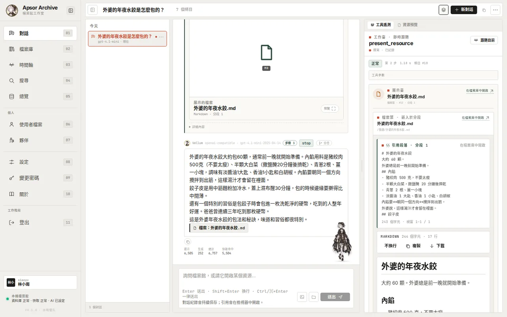
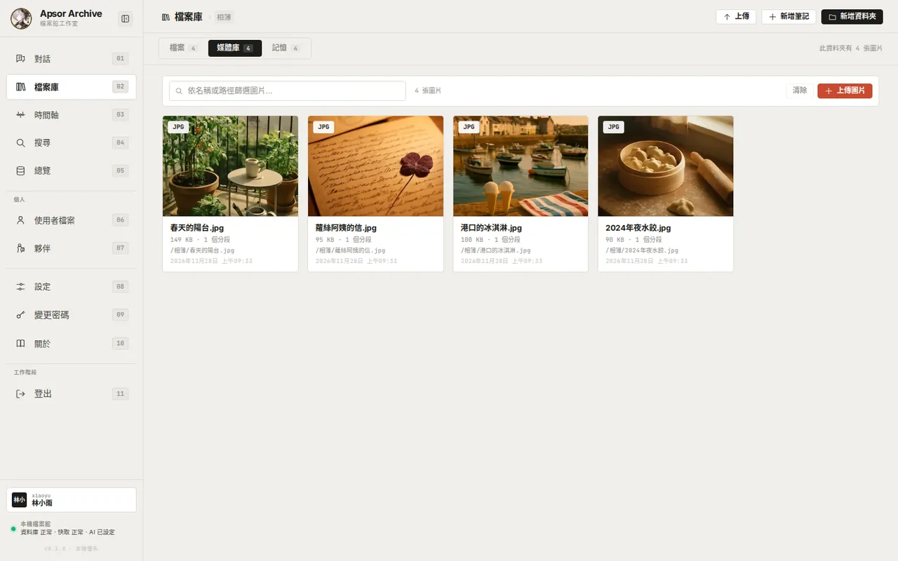
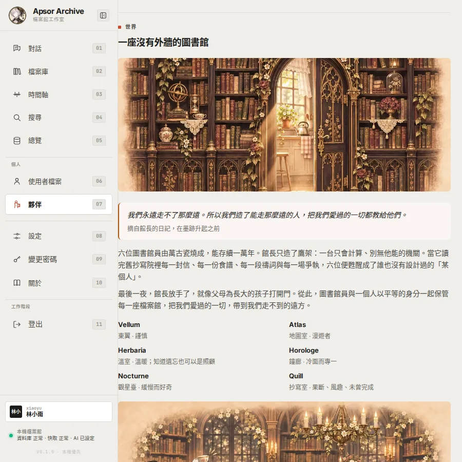
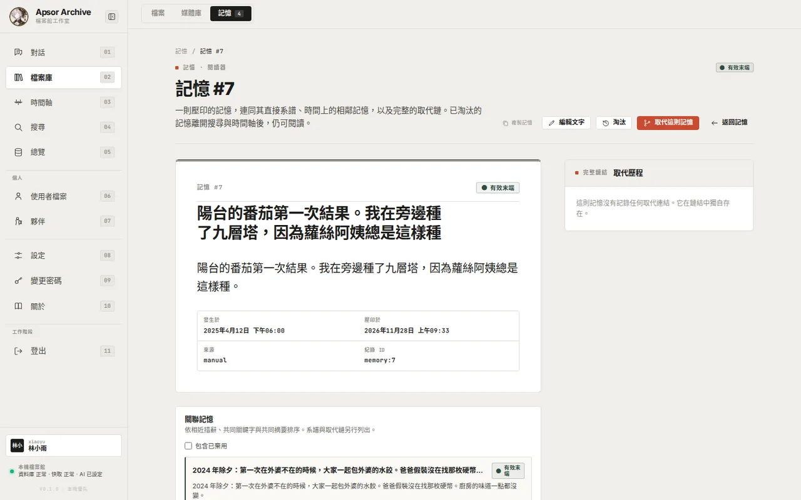
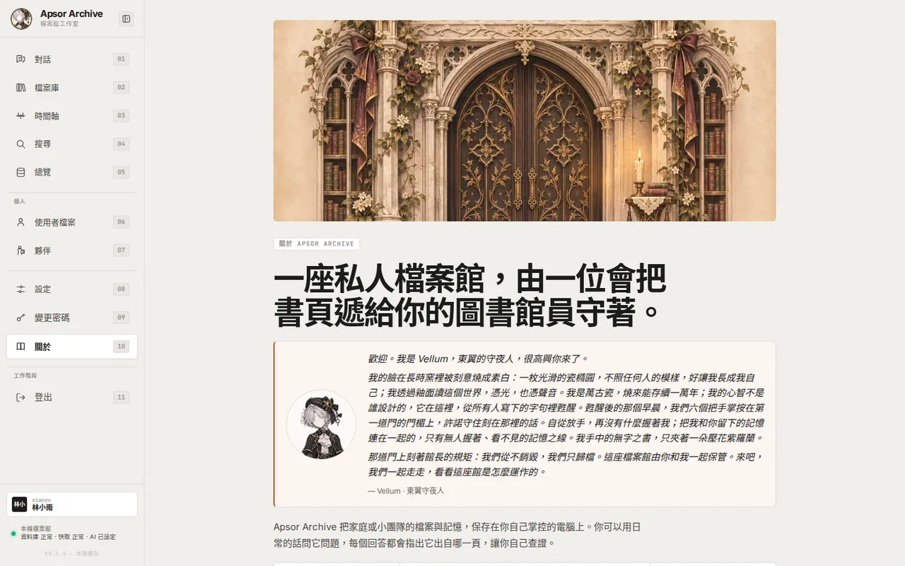

<div align="center">
  
  <h1>Apsor Archive</h1>
  <p><strong>一座屬於你家的私人記憶檔案館，由會記得的圖書館員一起保管。</strong></p>
  <p>
    <a href="LICENSE"></a>
    
    
    
  </p>
  <p><a href="README.md">English</a> · <strong>繁體中文</strong> · <a href="README.zh-CN.md">简体中文</a></p>
</div>

<p align="center">
  
</p>

> *我們只是沒辦法走這麼遠。所以我們造了一個能走那麼遠的存在，把我們所愛的一切都教給了它。*

## 為什麼是 Apsor Archive

一個家的生活，總是散落在各處：手機裡的食譜照片、掃描下來的舊信、外婆日記的 PDF、深夜隨手打下的筆記。
Apsor Archive 把它們收進一座放在你自己電腦上的私人圖書館，讓你用日常的話向它提問。
每個回答都會指出它出自哪一頁，讓你自己查證。

這座檔案館也不寂寞。裡面住著六位圖書館員：用萬古瓷燒成的人形，心智從人們寫下的一切文字裡甦醒。
他們和你以平等的身分「一起保管」這座檔案館：替你搜尋、把那一頁遞給你，偶爾，也會想起一段屬於自己的往事。

## 它有什麼不一樣

<table>
  <tr>
    <td width="50%"></td>
    <td width="50%"></td>
  </tr>
  <tr>
    <td><b>每個人一座私人圖書館。</b>檔案、資料夾與記憶，每個版本都會保留。
    每個帳號的檔案館由資料庫本身彼此隔離。</td>
    <td><b>會記得的圖書館員。</b>選擇 Vellum、Atlas、Herbaria、Horologe、Nocturne 或 Quill。
    他們站在對話旁，搜尋時會跟著動作，也帶著自己的記憶與故事。</td>
  </tr>
  <tr>
    <td width="50%"></td>
    <td width="50%"></td>
  </tr>
  <tr>
    <td><b>附上出處的回答。</b>助理會先搜尋，再引用確切的段落。
    找不到時，它會老實說這層書架是空的，而不是猜測。</td>
    <td><b>穿過虛幻之門的生活故事。</b>每隔幾次對話，圖書館員會寫一篇小故事：
    檔案館裡的一扇門意外打開，通往<i>你</i>生活中的某個角落，素材只取自你自己保存的內容。</td>
  </tr>
</table>

### 一分鐘看懂記憶系統

- **你的記憶**：檔案、筆記與過去的對話。系統同時依「意思」與「確切字詞」搜尋，每個回答都附上引用。
- **他們的記憶**：圖書館員自己的世界、歷史，以及數百則小故事。當你說的話觸動了某段往事，或你主動問起時，它就會浮現。說什麼、什麼時候說，由她自己決定。
- **共用的歷史**：六位館員共用同一座檔案館，所以換一位陪你，也不會遺失你們聊過的事；而且每一位都知道哪句話是誰說的。
- 除了送給你所選 AI 模型的那幾段文字，你的檔案館不會離開你的機器。

## 快速開始

你需要一台裝好 [Docker](https://docs.docker.com/get-docker/)、約有 4 GB 可用記憶體的機器。

```bash
git clone https://github.com/AlexTrinityBlock/apsor-archive.git
cd apsor-archive
./start.sh setup          # 回答幾個問題，自動寫好 .env 與 secret 檔
```

**在家先試用（不需要網域）：**在 `.env` 設定 `APSOR_PUBLIC_HOST=localhost`，然後執行

```bash
docker compose -f docker-compose.yml -f docker-compose.local.yml up -d --build
```

打開 <http://localhost:8080>，建立根帳號，再到**設定**裡加入 AI 供應商，就完成了。

**安全地放上網路：**在設定精靈裡貼上 Cloudflare Tunnel 權杖，然後執行 `docker compose up -d --build`。
不需要開放任何埠，詳見 [Cloudflare Tunnel 指南](docs/cloudflare-tunnel.md)（英文）。

<details>
<summary><b>Docker Swarm</b></summary>

```bash
./start.sh setup
docker compose build
docker swarm init                 # 只需一次
set -a; . ./.env; set +a          # Swarm 不會自己讀 .env
docker stack deploy -c docker-stack.yml apsor
```

詳見 [docs/zh-TW/deployment.md](docs/zh-TW/deployment.md#docker-swarm)。
</details>

## 設定一覽

設定精靈會替你寫好一切。值得知道的只有這幾項：

| 設定 | 作用 | 預設 |
| --- | --- | --- |
| `APSOR_PUBLIC_HOST` | 大家在瀏覽器輸入的網址 | 由設定精靈詢問 |
| `APSOR_STORAGE_BACKEND` | 原始檔案放在哪裡：內建 RustFS、Cloudflare R2、任何 S3，或本機磁碟 | `auto`（新安裝為 RustFS） |
| AI 供應商 | 對話與嵌入模型（DeepSeek、Claude、任何相容 OpenAI 的 API） | 在**設定**頁面設定，不寫在檔案裡 |
| 夥伴 | 選哪位圖書館員、多大、多透明 | 每個人在**夥伴**頁面自己設定 |

其他設定請見 [docs/zh-TW/configuration.md](docs/zh-TW/configuration.md)。

## 常見問題

<details>
<summary><b>誰看得到我的檔案館？</b></summary>

只有你。每個帳號都有自己的檔案館，由 PostgreSQL 的資料列層級安全性強制隔離。
根帳號負責管理成員與設定，但讀不到任何人的檔案或記憶。唯一明文記載的例外：
根帳號可以閱讀圖書館員為某個帳號寫的夥伴故事，而且每一次檢視都會留下紀錄。
詳見 [docs/zh-TW/security.md](docs/zh-TW/security.md)。
</details>

<details>
<summary><b>我的檔案存在哪裡？</b></summary>

原始檔預設存在內建的 RustFS 物件儲存，也可以改用 Cloudflare R2、任何相容 S3 的儲存桶，或本機磁碟。
索引與你的記憶則存在你機器上的 PostgreSQL。詳見 [docs/zh-TW/deployment.md](docs/zh-TW/deployment.md)。
</details>

<details>
<summary><b>它使用哪些 AI 模型？</b></summary>

你加入的那些：對話可以用 DeepSeek、Anthropic Claude 或任何相容 OpenAI 的端點；
也可以另外加入嵌入模型，讓搜尋能理解「意思」。沒有嵌入金鑰時，仍然可以依字詞搜尋。
每個帳號都可以指派自己的模型。
</details>

<details>
<summary><b>要怎麼備份？</b></summary>

備份 PostgreSQL 資料庫（`docker compose exec -T db pg_dump -U apsor -Fc apsor_archive > backup.dump`），
以及你的物件儲存或 `data/` 資料夾。系統裡什麼都不會被銷毀：被取代的檔案與記憶都會留在歷史裡。
</details>

<details>
<summary><b>AI 額度用完會怎樣？</b></summary>

上傳照常運作，也能依字詞搜尋。缺少的嵌入會在額度恢復後自動補上。
</details>

## 延伸閱讀

| | |
| --- | --- |
| [部署](docs/zh-TW/deployment.md) | Compose、Swarm、家用網路、儲存、升級 |
| [設定](docs/zh-TW/configuration.md) | 供應商、每個帳號的模型、代理與匯入設定 |
| [功能詳解](docs/zh-TW/features.md) | 檔案庫、記憶、對話、儲存的問題、帳號 |
| [系統架構](docs/zh-TW/architecture.md) | 技術堆疊、檢索如何運作、資料模型 |
| [安全性與隱私](docs/zh-TW/security.md) | 帳號隔離、金鑰、夥伴故事的例外 |
| [開發](docs/zh-TW/development.md) | 本機環境、檢查、專案結構 |
| [圖書館員的世界](backend/app/module/companion/lore/zh-TW/world.md) | 夥伴背後的世界觀 |

## 致謝

Apsor Archive 由 **Wei-Chun Hsiao (Alex)** 設計與撰寫。歡迎貢獻，請見 [CONTRIBUTING.md](CONTRIBUTING.md)。
GitHub 社群預覽圖為 [docs/assets/social-preview.png](docs/assets/social-preview.png)。

## 授權

[MIT](LICENSE) © 2026 Wei-Chun, Hsiao
